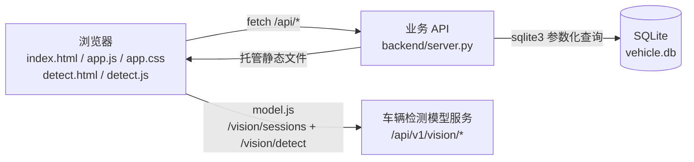
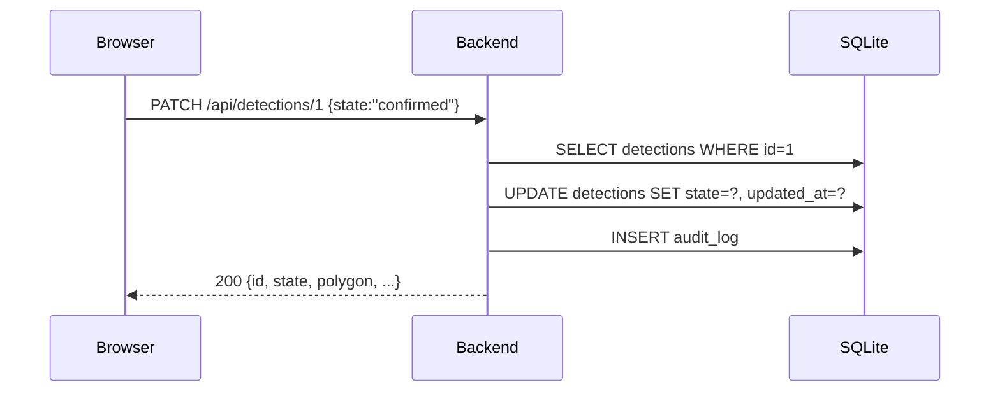
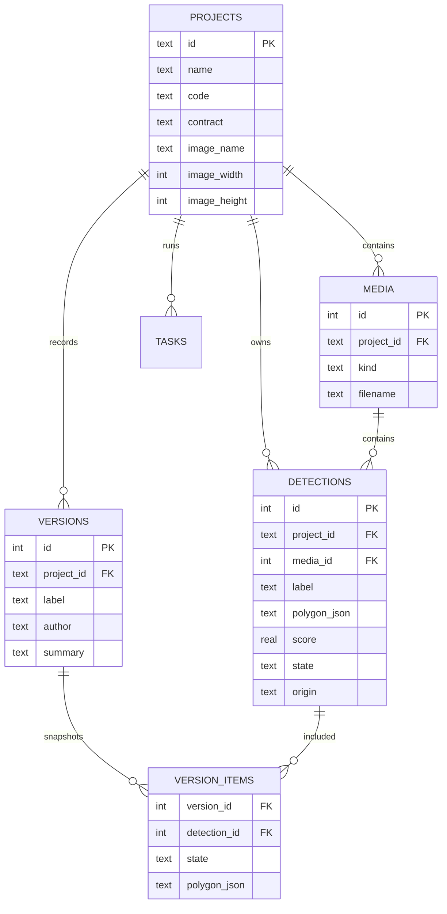
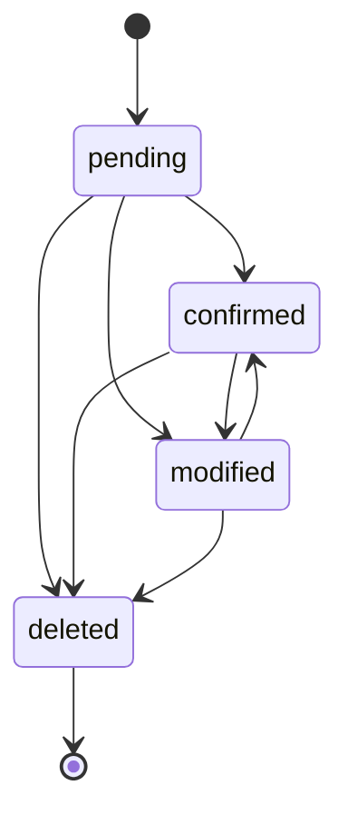
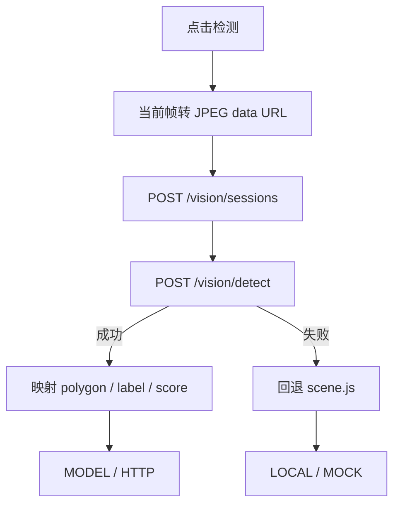

# VECTOR 车辆检测复核系统 — 设计文档

| 项目 | 内容 |
|---|---|
| 文档版本 | 1.0 |
| 日期 | 2026-11-15 |
| 系统名称 | VECTOR 车辆检测复核系统 |
| 代码位置 | `vehicle-platform/` |
| 运行入口 | `http://127.0.0.1:8100/index.html` |
| 数据存储 | SQLite 3 |
| 文档状态 | 与当前 `frontend`、`backend`、`database` 同步 |

---

## 1. 设计目标

### 1.1 业务目标

为物流园车辆巡查提供一个可操作的检测与人工复核工作台：

- 从影像中读取车辆候选框；
- 人工确认、修改、删除旋转框；
- 将复核结果保存为可回看的版本；
- 按区域中心点统计车辆数量；
- 输出 JSON / CSV / PNG 报告；
- 在模型服务可用时调用模型，不可用时明确回退；
- 保留完整的规格、交互、测试和交付记录。

### 1.2 设计约束

| 约束 | 说明 |
|---|---|
| 无构建步骤 | 前端直接使用 HTML / CSS / 原生 JavaScript，打开即用 |
| 无第三方运行时 | 后端只用 Python 标准库，数据库使用 SQLite |
| 单仓交付 | 前端、后端、数据库、测试、文档在同一目录 |
| 可审查 | 所有业务数据通过 API 访问，前端不直接读写数据库 |
| 可回退 | 模型不可用时使用本地演示数据，并显式标记 `LOCAL / MOCK` |
| 可验证 | 关键流程必须有 API 测试、浏览器测试或截图证据 |

### 1.3 非目标

当前版本不包含：

- 真实账号体系、SSO、找回密码；
- 多租户隔离与并发写冲突控制；
- 视频逐帧检测与流式推理；
- 生产级对象存储和大规模影像管理；
- 模型训练与标注平台。

---

## 2. 总体架构



### 2.1 分层

| 层 | 职责 | 主要文件 |
|---|---|---|
| 表现层 | 九个模块、复核画布、检测画布、反馈与动效 | `frontend/index.html`、`app.js`、`app.css` |
| 检测交互层 | 图片加载、模型调用、框编辑、AI 配置 | `frontend/detect.html`、`detect.js` |
| 数据桥接层 | 业务 API 与模型 API 的前端适配 | `frontend/data-api.js`、`model.js` |
| 业务服务层 | 项目、目标、版本、任务、统计 | `backend/server.py` |
| 数据层 | 表结构、约束、种子数据、快照 | `database/schema.sql`、`seed.sql` |
| 验证层 | API 与边界测试 | `tests/test_api.py` |

### 2.2 请求路径

1. 浏览器加载 `index.html` 与静态资源；
2. 登录后，`data-api.js` 请求 `/api/projects/{id}` 与 `/api/projects/{id}/detections`；
3. 复核确认 / 删除通过 `PATCH /api/detections/{id}` 落库；
4. 保存修订通过 `POST /api/projects/{id}/versions` 生成快照；
5. 智能检测通过 `model.js` 请求模型服务，失败时回退到 `scene.js`。

---

## 3. 前端设计

### 3.1 信息架构

| 编号 | 模块 | 主要职责 |
|---|---|---|
| 01 | 项目总览 | 项目、影像、候选数、已复核数、最新版本 |
| 02 | 检测任务 | 9 个切片、进度、临时 / 最终计数 |
| 03 | 复核台 | 目标列表、Canvas 旋转框、属性面板、版本保存 |
| 04 | 智能检测 | 图片接入、整帧检测、模型 / AI 接口 |
| 05 | 疑难队列 | 低置信度、贴边、遮挡等复核队列 |
| 06 | 区域计数 | 圈选区域、中心点归属、全图口径 |
| 07 | 修订档案 | 版本列表、快照摘要、只读回看 |
| 08 | 报告输出 | JSON / CSV / PNG 导出 |
| 09 | 使用说明 | 九模块说明、快捷键、AI 接入说明 |

### 3.2 页面结构

```text
┌──────────────────────────────────────────────────────────────┐
│ 指令条：坐标 / 项目 / 同步状态 / 用户 / 退出                │
├──────────────┬───────────────────────────────────────────────┤
│ 左侧模块栏   │ 视图根节点 #view-root                          │
│ #rail-nav    │  ├─ 页头                                      │
│ #rail-ink    │  ├─ 指标卡 / 卡片                              │
│ 用户 / 项目  │  ├─ Canvas / 表格 / 队列                       │
│              │  └─ 底部 ticker                                │
└──────────────┴───────────────────────────────────────────────┘
```

- 左侧模块栏是全局导航；移动端变为顶部横向滚动。
- `#rail-ink` 是随当前模块移动的橙色指示条。
- 页面不刷新，通过 `go(view)` 切换视图。
- 每个视图由 `app.js` 的 `viewXxx()` 函数渲染。

### 3.3 状态模型

```js
state = {
  view: "project",
  user: "lin.analyst",
  project: { id, name, code, role, contract },
  detections: [],       // 车辆框
  versions: [],         // 版本快照摘要
  selected: null,       // 当前目标 id
  filter: "all",        // all / pending / confirmed / modified
  task: null,           // 检测任务
  stats: { regions: [] },
  remote: false,        // 是否已接 SQLite API
  wb: { img, scale, ox, oy }
}
```

状态只存在内存中；登录会话写入 `localStorage` 的 `vector.session.v1`，AI 配置写入 `vector.ai.v1`。

### 3.4 设计令牌

| 令牌 | 值 | 用途 |
|---|---|---|
| `--paper` | `#f2ede3` | 页面底色 |
| `--cream` | `#fbf7ee` | 卡片 / 面板 |
| `--ink` | `#17211d` | 主文字 |
| `--deep` | `#1f4b43` | 深绿结构色 |
| `--orange` | `#c75b36` | 信号色、主按钮、当前状态 |
| `--muted` | `#6e7972` | 次要信息 |
| `--line` | `#d8cdbb` | 分割线 |
| 衬线标题 | `Noto Serif SC` | 页头与模块标题 |
| 等宽标签 | `IBM Plex Mono` | 编号、坐标、状态 |

视觉语言：纸面、墨色、大号衬线标题、细规则线、小号等宽标签、橙色作为唯一高饱和信号色。

### 3.5 复核台设计

```text
┌──────────────┬──────────────────────────────┬──────────────┐
│ 目标列表      │ Canvas 画布                   │ 目标详情      │
│ 筛选 / 状态   │ yard.svg + 旋转框             │ 中心 / 宽高   │
│ #01–#09      │ 选中 / 缩放 / 平移            │ 四角坐标      │
│              │ 画布 HUD / 缩放比例           │ 确认 / 删除   │
└──────────────┴──────────────────────────────┴──────────────┘
```

交互：

- 点击目标行或画布框选中目标；
- `Delete` 删除当前框；
- `Ctrl+Z` / `Ctrl+Y` 撤销 / 重做；
- 目标中心点落入区域才计入区域数量；
- 确认 / 删除立即更新本地视图，再通过 API 同步；
- 同步失败时恢复原状态并提示错误；
- 保存修订写入 `versions` 与 `version_items`。

### 3.6 智能检测设计

- 三栏布局：媒体 / 目标列表、画布、属性 / AI 面板。
- 支持载入图片；画布显示原图与检测框。
- `runDetect()` 将当前帧转为 JPEG data URL，调用 `model.js`。
- 模型返回 `detections[].polygon / label / score` 后映射为画布框。
- 模型不可达时回退 `scene.js`，引擎标记 `LOCAL / MOCK`。
- 检测中显示扫描线与按钮 spinner；数量变化时执行 count bump。
- AI 配置保存在 `localStorage`，支持接口地址、模型名与 Token。

### 3.7 交互反馈

| 场景 | 反馈 |
|---|---|
| 登录空值 | 表单 shake、输入框红边、自动聚焦、错误文案 |
| 登录成功 | 按钮 spinner「正在进入…」、页面加载遮罩 |
| API 请求 | `同步中…` 状态脉冲 |
| 保存版本 | 按钮「保存中…」并禁用 |
| 任务检测 | 按钮「检测中…」、切片 RUN 状态、进度条 |
| 模型检测 | 按钮 spinner、扫描线、引擎状态 |
| 成功 / 失败 | toast；失败时明确错误码与回退 |
| 键盘操作 | `focus-visible` 轮廓；快捷键提示 |

### 3.8 动效

保留 sibal 风格的节奏，但使用项目自己的视觉语言：

- 启动序列：00–05 计数、描边大数字、SKIP INTRO；
- rail ink：当前模块橙色滑条；
- 视图错峰入场；
- 指标数字递增；
- 详情面板 flash；
- 检测扫描线；
- ticker 滚动；
- 自定义光标 + 磁吸按钮；
- 滚动 reveal；
- `prefers-reduced-motion` 下全部降级。

### 3.9 响应式

| 断点 | 行为 |
|---|---|
| ≥ 1120px | 左侧栏 + 三栏复核台 / 双列说明目录 |
| 820–1119px | 复核属性下移，说明目录单列或双列过渡 |
| ≤ 819px | 左侧栏变顶部横向导航，页面单列 |
| ≤ 560px | 指标 2 列、按钮全宽、表格横向滚动 |

移动端 `.tl-rail` 与 `.tl-work` 使用 `min-width:0`，避免横向溢出；当前模块自动滚动到可见位置。

### 3.10 可访问性

- 所有表单有 `label`；
- 按钮有 `aria-label` 或可见文本；
- 状态变化使用 `role="status"` / `role="alert"`；
- 键盘可完成登录、复核删除、区域绘制；
- 颜色对比度按正文 4.5:1 目标校正；
- 动效关闭遵循系统 `prefers-reduced-motion`。

---

## 4. 后端设计

### 4.1 技术选择

- Python 标准库 `http.server.ThreadingHTTPServer`；
- `sqlite3` 参数化查询；
- 同时托管 `frontend/` 静态文件与 `/api`；
- 无 Flask / FastAPI / ORM 依赖，降低部署门槛；
- 单文件服务便于课程交付与审查。

### 4.2 路由

| 方法 | 路径 | 说明 |
|---|---|---|
| GET | `/api/health` | 服务状态 |
| GET | `/api/projects/{id}` | 项目 + 状态计数 |
| GET | `/api/projects/{id}/detections` | 车辆目标列表 |
| PATCH | `/api/detections/{id}` | 修改 state / note / label |
| POST | `/api/projects/{id}/detections` | 新增 AI 补框 |
| GET | `/api/projects/{id}/stats` | 区域 / 全图统计 |
| GET | `/api/projects/{id}/versions` | 版本列表 |
| POST | `/api/projects/{id}/versions` | 保存版本快照 |
| POST | `/api/projects/{id}/tasks` | 创建任务记录 |

### 4.3 请求生命周期



### 4.4 错误模型

统一返回：

```json
{
  "error": {
    "code": "BAD_STATE",
    "message": "复核状态非法"
  }
}
```

| HTTP | code | 场景 |
|---|---|---|
| 400 | `BAD_JSON` | 请求体不是合法 JSON |
| 404 | `PROJECT_NOT_FOUND` | 项目不存在 |
| 404 | `DETECTION_NOT_FOUND` | 目标不存在 |
| 422 | `BAD_STATE` | 复核状态非法 |
| 422 | `BAD_POLYGON` | 多边形少于 3 点 |
| 422 | `BAD_LABEL` | 车辆类别非法 |
| 403 | `FORBIDDEN` | 静态路径越界 |

### 4.5 校验

- `state ∈ {pending, confirmed, modified, deleted}`；
- `label ∈ {car, truck, van, bus}`；
- `polygon` 至少 3 个点；
- `score ∈ [0, 1]`；
- 所有 SQL 使用参数化查询；
- 静态文件路径解析后必须仍位于 `frontend/` 下。

---

## 5. 数据库设计

### 5.1 ER 图



### 5.2 表说明

| 表 | 作用 | 关键约束 |
|---|---|---|
| `projects` | 项目与影像元信息 | `code` 唯一；宽高 > 0 |
| `media` | 影像 / 视频 | `kind ∈ image, video` |
| `detections` | 车辆旋转框 | `state` / `label` / `score` 约束 |
| `tasks` | 检测任务 | `status ∈ running, done, cancelled, failed` |
| `versions` | 人工版本 | 关联项目与作者 |
| `version_items` | 版本快照 | 复合主键 `(version_id, detection_id)` |
| `audit_log` | 操作审计 | 记录 action / target / detail |

### 5.3 状态机



### 5.4 版本快照

保存版本时：

1. 插入 `versions`；
2. 把当前项目所有 `detections` 的 `state / polygon_json / note` 写入 `version_items`；
3. 写入 `audit_log`；
4. 整个操作在同一连接内提交。

优点：版本可回看、可对比、不可被后续修改影响。  
代价：每个版本保存全量快照；当前 9 个目标规模可接受。

### 5.5 种子数据

- 1 个项目：车辆巡查 A 区 / `PRJ-V-0271`；
- 1 张影像：`yard.svg`，1800 × 1200；
- 9 个车辆目标：4 个 car、3 个 truck、2 个 van；
- 1 个已完成任务：9/9 切片；
- 1 个 v0 版本 + 9 条快照。

---

## 6. 模型接入设计

### 6.1 契约

```text
POST {baseUrl}/api/v1/vision/sessions
POST {baseUrl}/api/v1/vision/detect
```

请求体：

```json
{
  "session_id": "ses_xxx",
  "mode": "full",
  "image": {
    "data_url": "data:image/jpeg;base64,...",
    "width": 1800,
    "height": 1200
  }
}
```

响应：

```json
{
  "request_id": "req_xxx",
  "model": { "name": "vehicle-obb", "version": "test" },
  "elapsed_ms": 12,
  "detections": [
    {
      "id": "d1",
      "label": "truck",
      "score": 0.99,
      "polygon": [[760,300],[905,290],[910,332],[765,342]],
      "source": "model"
    }
  ]
}
```

### 6.2 前端流程



### 6.3 回退原则

- 不把本地演示结果标记为模型结果；
- 回退时保留可操作的 9 个车辆框；
- 状态栏、引擎标签和 toast 三处同时提示；
- 接口超时 20 秒，失败立即回退；
- 模型返回空数组视为失败，不显示空画布。

---

## 7. 关键设计决策

| 决策 | 选择 | 理由 | 代价 |
|---|---|---|---|
| 静态托管 | 后端同时托管前端 | 避免跨域与双服务启动 | 前后端耦合在一个进程 |
| 数据库 | SQLite | 零配置、可随代码提交 | 并发与大数据能力有限 |
| 前端构建 | 无构建 | 降低运行门槛，便于审查 | 无打包优化与类型检查 |
| 状态管理 | 单文件 `state` + 视图函数 | 逻辑直观，易于追踪 | 规模扩大后需要模块化 |
| 画布 | 原生 Canvas 2D | 可控的旋转框与命中测试 | 需自行处理 DPR 与缩放 |
| 模型回退 | 显式 `LOCAL / MOCK` | 避免伪造模型结果 | 演示数据需与业务一致 |
| 版本 | 全量快照 | 实现简单、可回看 | 存储随版本线性增长 |

---

## 8. 性能与可靠性

- 首屏只加载本地 HTML / CSS / JS / SVG，无第三方脚本；
- 图片使用 SVG 场景，避免大位图；
- Canvas 按设备像素比设置尺寸，避免模糊；
- API 查询按 `project_id` / `state` 建索引；
- 版本保存使用单连接事务；
- 模型请求 20s 超时，失败回退；
- 前端在 API 失败时保留本地状态，并提示用户。

### 8.1 容量估算

当前演示数据：

- 1 个项目、1 张影像、9 个目标、1 个版本；
- 单版本快照 9 行；
- SQLite 文件 < 100 KB。

扩展到 1 万目标、100 个版本时，`version_items` 约 100 万行；届时建议：

- 改为增量版本或差异快照；
- 按项目分区；
- 迁移到 PostgreSQL；
- 影像放对象存储。

---

## 9. 安全与边界

| 风险 | 处理 |
|---|---|
| SQL 注入 | 全部参数化查询 |
| 路径穿越 | 静态路径解析后校验是否仍在 `frontend/` 下 |
| 非法状态 | 数据库 CHECK + API 422 |
| 非法标签 | API 422 + 前端选项约束 |
| 模型伪造 | 明确 `LOCAL / MOCK`，不冒充模型 |
| 会话 | 演示级 `localStorage`，非真实鉴权 |
| 跨域 | 同源托管；API 允许 CORS 便于本地调试 |
| 敏感信息 | 不把 Token 写入日志；AI 配置只存本地 |

> 当前账号体系为课程演示，不适用于生产。生产需要服务端会话、密码哈希、权限模型与审计。

---

## 10. 测试设计

| 层级 | 内容 | 证据 |
|---|---|---|
| API 测试 | health、项目、目标、PATCH、版本、补框、非法状态、404 | `tests/test_api.py` |
| 数据库测试 | 计数、快照、约束、索引 | `docs/TEST_REPORT.md` |
| 前端测试 | 登录、任务、复核、区域、说明页 | 浏览器操作 + 截图 |
| 响应式 | 1440 / 1026 / 390 | 截图 + `scrollWidth` 检查 |
| 模型测试 | 桩接口 `MODEL / HTTP`；离线 `LOCAL / MOCK` | 接口桩 + 断网 |
| 回归 | 数据库重建后初始 9 个 pending | `build_db.py` |

测试原则：

- 每个 API 用例有明确状态码与字段断言；
- 每个前端场景有可复现操作步骤；
- 测试后重建数据库，避免演示状态被污染；
- 不用“页面看起来对”替代数据库查询。

---

## 11. 部署与运行

### 11.1 本地运行

```bash
cd vehicle-platform
python database/build_db.py
python backend/server.py
```

打开：

```text
http://127.0.0.1:8100/index.html
```

### 11.2 目录

```text
vehicle-platform/
├─ frontend/
│  ├─ index.html
│  ├─ app.js / app.css
│  ├─ detect.html / detect.js / detect.css
│  ├─ data-api.js / model.js / scene.js
│  ├─ assets/yard.svg
│  └─ screenshots/
├─ backend/server.py
├─ database/
│  ├─ schema.sql
│  ├─ seed.sql
│  ├─ build_db.py
│  └─ vehicle.db
├─ tests/test_api.py
└─ docs/
   ├─ SPEC.md
   ├─ DESIGN.md
   ├─ INTERACTION_LOG.md
   ├─ AI_COLLAB.md
   ├─ TEST_REPORT.md
   ├─ DATABASE.md
   └─ REPORT.docx
```

### 11.3 模型服务

可选，默认地址：

```text
http://127.0.0.1:8000
```

未启动时系统仍可运行，检测页显示 `LOCAL / MOCK`。

---

## 12. 扩展路线

1. **视频检测**：按帧采样、任务队列、逐帧框合并；
2. **真实鉴权**：服务端会话、角色权限、项目成员表；
3. **并发控制**：目标级乐观锁、版本冲突提示；
4. **数据库升级**：MySQL / PostgreSQL + 迁移脚本；
5. **任务队列**：异步切片推理、失败重试、进度推送；
6. **导出模板**：可配置 PDF 报告、项目封面与签核栏；
7. **可观测性**：请求日志、错误率、模型耗时指标；
8. **组件化**：把九个视图拆分为独立模块，保留无构建入口。

---

## 13. 需求映射

| 需求 | 设计位置 | 实现 | 验证 |
|---|---|---|---|
| F1 登录 | 3.3 / 4.2 | `#auth-form`、`vector.session.v1` | 空值 / 刷新 / 退出 |
| F2 项目总览 | 3.1 | `viewProject()` | 9 个候选 |
| F3 检测任务 | 3.5 | `viewTask()` | 9/9 切片 |
| F4 复核台 | 3.5 | `viewWorkbench()` | 确认 / 删除 |
| F5 AI 补框 | 3.5 / 6 | `addAiBox()` + API | `origin=ai` |
| F6 区域计数 | 3.1 / 3.5 | `viewStats()` | 5 个中心点 |
| F7 版本档案 | 5.4 | `saveVersion()` | 快照 9 条 |
| F8 报告输出 | 3.1 | `exportAs()` | JSON / CSV |
| F9 模型接入 | 6 | `model.js` | `MODEL / HTTP` / `LOCAL / MOCK` |
| F10 使用说明 | 3.1 / 3.9 | `viewGuide()` | 三档宽度 |
| N8 交互反馈 | 3.7 | `setBusy` / ripple / loader | 空表单 / 保存 / 检测 |

---

## 14. 术语

| 术语 | 含义 |
|---|---|
| 旋转框 | 车辆目标的四点多边形，不局限于水平矩形 |
| 切片 | 将大图切成 9 块进行检测的单元 |
| 临时候选 | 切片检测后尚未合并的数量 |
| 最终数量 | 合并去重并经过复核的数量 |
| 中心点归属 | 目标中心点落在区域内才计数 |
| 版本快照 | 某一时刻所有目标状态的只读副本 |
| `LOCAL / MOCK` | 模型不可用时的本地演示状态 |
| `MODEL / HTTP` | 模型服务正常返回的状态 |

---

## 15. 文档维护

- 本文件与 `SPEC.md` 同步维护；
- 修改数据库或接口时，先更新本文件与 SPEC，再改代码；
- 新增视图时，补充 3.1 模块表与 13 需求映射；
- 新增 API 时，补充 4.2 路由表与 4.4 错误码；
- 每次报告提交前，检查本文件中的路径、端口、测试数量与实际一致。
